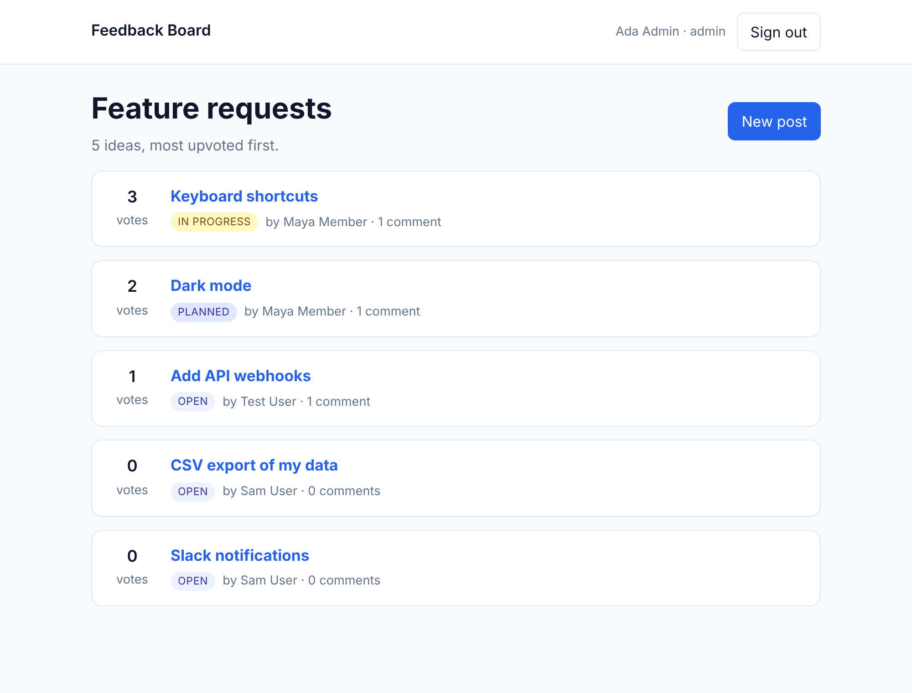

# Feedback Board

[](https://github.com/smrafi4130/feedback-board/actions/workflows/ci.yml)

A full-stack product feedback board — users post feature requests, upvote, comment, and admins triage status — built with the **Next.js App Router**, **React Server Components**, **Server Actions**, **Postgres** (via Drizzle) and cookie-based auth.



## Why this project

It demonstrates a complete, deployable full-stack slice with the parts that matter in production: a typed database layer with real constraints, authentication and authorization enforced on the server, caching that stays correct after writes, and tests at the unit, database-integration and end-to-end levels.

## Architecture

```
src/
  app/            App Router routes (Server Components) + layout
  components/     Client Components: VoteButton, forms, admin control
  features/       posts-repo (pure data access) · *-queries (cached reads) · *-actions (server actions)
  db/             Drizzle schema, schema.sql, driver selection (PGlite / Postgres)
  lib/            password hashing, Zod validation, session management
```

- **Reads** are Server Components querying the database directly — no client fetching, no API layer. The board is wrapped in `unstable_cache` with a tag; **every write calls `revalidateTag`**, so reads are cached but never stale (ADR-0001).
- **Writes** are Server Actions with server-side Zod validation. Authorization (admin-only status changes, auth-only posting) is enforced in the action.
- **Data access** lives in `features/posts-repo.ts` as pure functions over a Drizzle database with no Next.js imports — which is what the integration tests exercise.
- **Auth**: scrypt-hashed passwords, opaque session tokens in an httpOnly cookie backed by a `sessions` table (ADR-0003).

Decisions are recorded in [docs/adr](docs/adr).

## Database

Drizzle ORM. With no `DATABASE_URL`, the app uses **PGlite** — real Postgres compiled to WASM, in-process — for dev, tests and CI, so there is nothing to install. In production, set `DATABASE_URL` and switch the driver to node-postgres; the queries are identical (ADR-0002). The one-vote-per-user rule is a database unique index, not just a UI check, and is tested as such.

## Run it

```bash
pnpm install
PGLITE_DATA=.pglite pnpm db:seed      # demo data (admin@/maya@/sam@example.com, password: "password")
PGLITE_DATA=.pglite pnpm dev          # http://localhost:3000

pnpm lint && pnpm typecheck && pnpm test && pnpm build
pnpm e2e                               # Playwright against the production server
```

## Testing

| Layer                | Tool                          | Covers                                                                                                                                        |
| -------------------- | ----------------------------- | --------------------------------------------------------------------------------------------------------------------------------------------- |
| Unit                 | Vitest                        | password hashing, Zod validation                                                                                                              |
| Database integration | Vitest + PGlite               | board ordering by votes, vote toggle idempotency, the unique-vote **constraint**, cascade deletes, status updates — all against real Postgres |
| End-to-end           | Playwright (production build) | signup → post → optimistic vote → comment, form validation, generic auth error, admin-only status change                                      |

Last local run: 11 unit/integration tests and 4 E2E tests passing.

## Deployment

Any Node host or container (`pnpm build` then `pnpm start`). For production, provision managed Postgres, set `DATABASE_URL`, switch the driver in `src/db/client.ts` to node-postgres, and run Drizzle migrations from `./drizzle`. The cookie is `Secure` in production, so serve over HTTPS.

## Limitations (honest status)

- **The committed runtime uses PGlite**, not a networked Postgres. It is genuine Postgres (so the SQL and constraints are real), but it is per-process and not a production datastore; production needs the node-postgres swap described above.
- `unstable_cache` is a per-process cache here; a multi-instance deployment would use a shared cache. The tag-based invalidation pattern is unchanged.
- No email verification, password reset, rate limiting or pagination yet — all reasonable next steps, left out to keep the core legible.
- Session lookups hit the database each request; fine at this scale, cacheable later.

## License

MIT
